# 鱼快下班 · YuKuaiXiaBan

> 一个常驻桌面的下班倒计时小窗：看着还剩多久，顺便看看今天已经赚了多少，还有一条状态越来越好的大肥鱼陪着你。

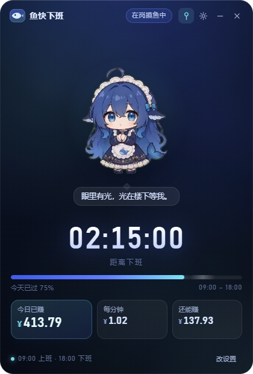

## 下载 / Download

**Windows x64 便携版（免安装）**：[前往 Releases 下载](https://github.com/getpar/yukuaixiaban/releases/latest)

- `YuKuaiXiaBan-1.1.1-portable.exe` — 单文件便携版，双击即用
- `YuKuaiXiaBan-1.1.1.zip` — 便携版 + 使用说明 + 第三方素材声明

> 首次运行 Windows 可能提示「未知发布者」（未做代码签名）→「更多信息」→「仍要运行」。
> 配置保存在 `%APPDATA%\鱼快下班\`。

## 功能

- **下班倒计时**：时:分:秒，按真实时间每 250ms 重算，不做累加，睡眠唤醒后不会漂移。
- **钱到分钟**：今日已赚 / 每分钟收入 / 今天还能赚，月薪 ÷ 每月计薪天数（默认 21.75）÷ 班次分钟数。
- **工作进度条**：今天过了多少，一眼看到。
- **大肥鱼桌宠（96 个动画全量接入）**：社区「蓝鲸娘 / 大肥鱼」透明动画，分三层调度：
  1. **基础情绪**：7 档随工作进度循环（睡觉 → 垂头叹气 → 打哈欠 → 踱步张望 → 期待开饭 → 雀跃庆祝 → 放烟花）；
  2. **随机摸鱼**：上班中每 25–60 秒随机播一个小动作（吃零食、撸猫、下五子棋、照镜子、玩魔方、打瞌睡被惊醒…）；
  3. **彩蛋**：整点前后随机来一段节日/撒欢动画（中秋赏月、放河灯、堆雪人、可爱宅舞…），今日已赚跨过 25% / 50% / 75% / 100% 时播「余额」小剧场（数金皱眉 → 钱袋如常 → 金袋叮当 → 钱袋满溢）。
- **戳一下有反应**：点击她会随机播放「点击回应」（元气挥手 / 开心跃动 / 害羞惊讶 / 傲娇生气 / 挠痒咯咯笑），并说一句摸鱼吐槽；鼠标移动会带一点点视差。
- **三种页面状态**：还没开工 / 在岗摸鱼中 / 午休中 / 下班啦（每自然日撒花一次）。
- **计薪方式**：月薪（可改计薪天数）或时薪两种口径随时切换。
- **午休不计薪**：可配置午休起止，进度和金额按有效工时走，午休时她会去睡觉，倒计时仍按真实时间。
- **下班提醒**：到点弹 Windows 通知 + 一段合成提示音，可分别关闭。
- **下班跑出桌面彩蛋**：到点后大肥鱼会从窗口里"钻出来"，在一个透明置顶的覆盖窗里沿桌面来回跑（默认"活跃"约 12 秒 / 2 趟，"安静"约 9 秒 / 1 趟），边跑边喊「下班啦——！」「溜了溜了～」「干饭去咯！」等台词，跑完跳一下撒花、挥手告别再消失。跑动做了**起步/收尾缓动、左右镜像朝向、步频与位移耦合（脚底不打滑）**、贴地不压任务栏、还会**躲开鼠标**。**点击穿透不挡办公**、任务栏无新图标；可在设置里关闭或切"安静/活跃"，开启「降低动态效果」时不触发。纯本地，不影响原有撒花/通知/记账。
- **开机自启**：设置里一键开启。
- **历史记录**：每天下班自动记一笔，设置面板「记录」页看最近 7 天与合计/日均。
- **自定义形象**：可以换成自己的图片或视频（存本机，不上传）。
- **无边框小窗**：420×620、圆角、可拖动、默认置顶，置顶开关会记住。
- **托盘入口**：显示/隐藏、置顶、设置、退出；悬停显示剩余时间。
- **降低动态效果**：设置里可暂停动画（只保留静帧）；系统开启「减少动态」时自动生效。
- **本地存储**：工资与时间只写在 `%APPDATA%\鱼快下班\settings.json`，全程不联网。

> **形象素材授权**：`assets/pet/*.webm` 来自社区项目 [PC2005-cloud/dsh-pet](https://github.com/PC2005-cloud/dsh-pet)，**CC BY-NC-SA 4.0（署名 · 非商业 · 相同方式共享）**，角色非 DeepSeek 官方形象。个人使用没问题；如需商业分发请先获授权，或切回原创 SVG 鱼（见 [THIRD-PARTY-NOTICES.md](THIRD-PARTY-NOTICES.md)）。

## 界面一览

| 上班前 · 沉睡鱼 | 上班中 · 眼里有光 | 下班啦 · 撒花 |
| --- | --- | --- |
| 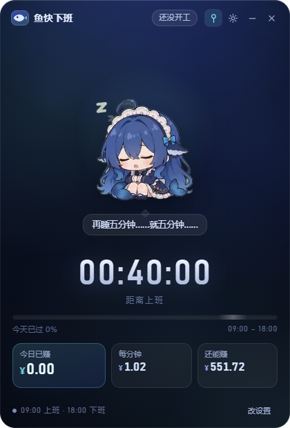 |  | 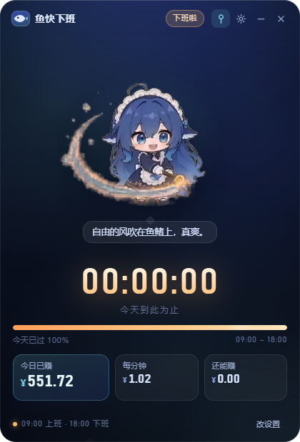 |

| 鱼饼瘫（刚开始上班） | 灵魂出窍（上午最难熬） | 归心似箭（最后冲刺） |
| --- | --- | --- |
| 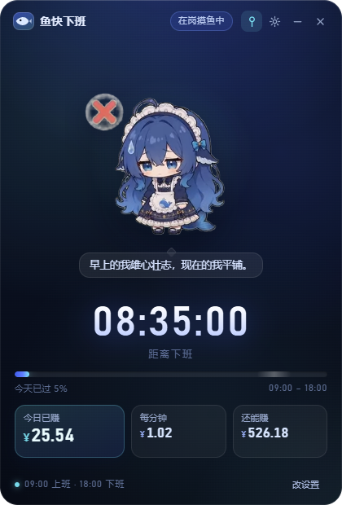 | 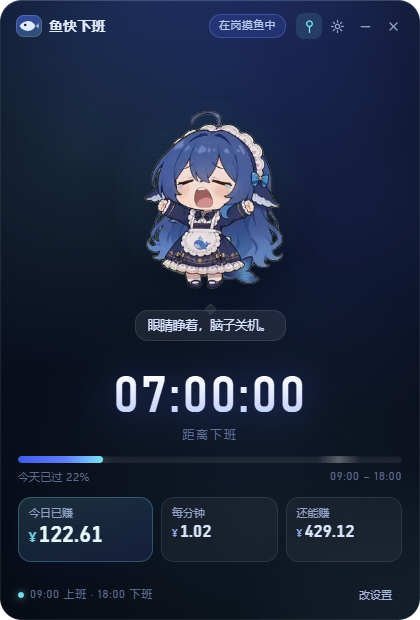 | 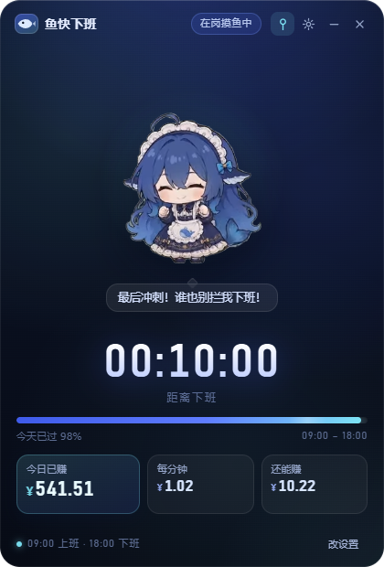 |

| 设置面板 | 首次启动 | 戳一下的反应 |
| --- | --- | --- |
| 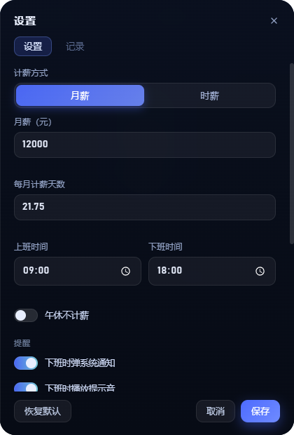 | 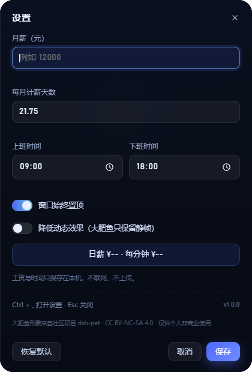 | 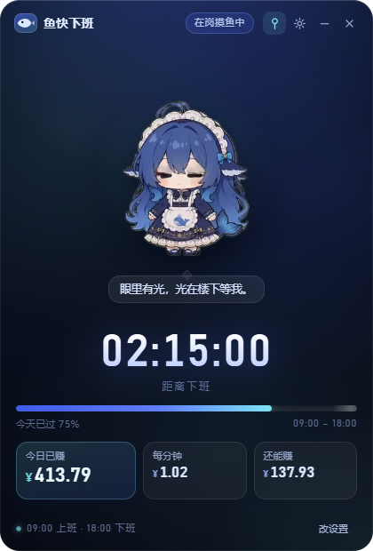 |

| 午休中（不计薪） | 记录页 | 摸鱼小动作 |
| --- | --- | --- |
| 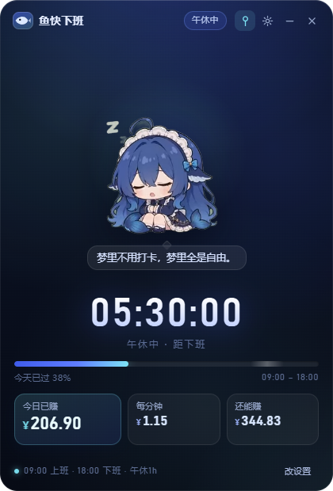 | 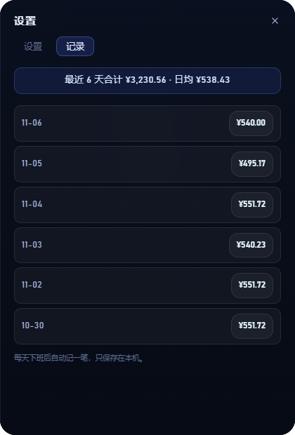 | 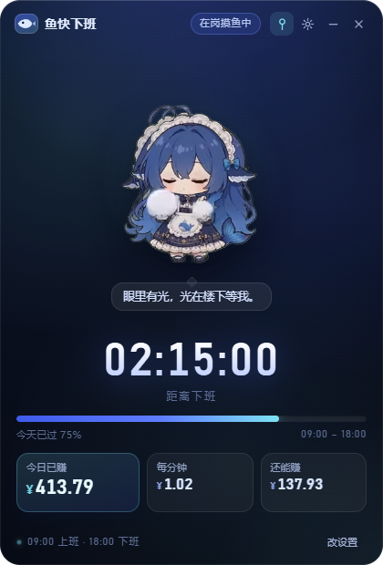 |

上班摸鱼时随机蹦出来的小动作（整点彩蛋 / 随机摸鱼）：


## 快速开始

```powershell
# 安装依赖（本机 PowerShell 禁用了 .ps1 脚本，统一用 npm.cmd）
npm.cmd install

# 启动
npm.cmd start

# 跑计算内核单元测试
node --test "tests/*.mjs"

# 打包 Windows 便携版 exe（输出到 release/）
npm.cmd run dist
```

> 如果 Electron 二进制没下载下来（npm 的脚本策略可能拦截 postinstall），手动执行：
> `$env:ELECTRON_MIRROR="https://npmmirror.com/mirrors/electron/"; node .\node_modules\electron\install.js`
>
> 另外：本机开发终端里若存在 `ELECTRON_RUN_AS_NODE=1`，启动前需要先清除，否则 Electron 会当成 Node 运行：
> `Remove-Item Env:ELECTRON_RUN_AS_NODE`

## 分发给同事

```powershell
# 打一个可以直接发人的压缩包：exe + 使用说明 + 素材声明
npm.cmd run dist
Compress-Archive -Path "release\YuKuaiXiaBan-1.1.1-portable.exe","release\使用说明.txt","release\THIRD-PARTY-NOTICES.md" `
  -DestinationPath "release\鱼快下班-v1.1.1.zip" -CompressionLevel Optimal
```

同事拿到 zip 解压后：

1. 双击 `YuKuaiXiaBan-1.1.1-portable.exe`（免安装、不需要管理员权限）；
2. Windows 会提示“未知发布者”（没买代码签名证书）→「更多信息」→「仍要运行」；
3. 首次启动填自己的月薪和上下班时间，设置存在各自的 `%APPDATA%\鱼快下班\`，互不影响。

> 发给同事时请连同 `THIRD-PARTY-NOTICES.md` 一起，保留署名与非商业约定。

## 首次使用

1. 启动后自动弹出设置面板（首次运行时工资为空）。
2. 填月薪（例如 12000）、每月计薪天数（默认 21.75）、上班/下班时间（默认 09:00 / 18:00）。
3. 保存即可；之后每次打开都按当天时间自动进入对应状态，可在托盘或「改设置」里随时修改。

## 计算口径

```
日薪       = 月薪 ÷ 每月计薪天数
每分钟收入 = 日薪 ÷ 班次分钟数
今日已赚   = 日薪 × 工作进度
今天还能赚 = 日薪 − 今日已赚
```

- 午休不单独切分：上班到下班之间的全部时间都计薪。
- 跨夜班次（下班时间早于上班时间）按次日下班计算。
- 金额只在本机计算，保留完整精度，展示时四舍五入到分。

## 目录结构

```text
XiaBan/
├─ electron/
│  ├─ main.cjs          # 窗口、托盘、单实例、设置与窗口位置持久化
│  ├─ runner.cjs        # 下班跑步彩蛋：透明覆盖窗 + 桌面路线动画
│  └─ preload.cjs       # contextBridge 白名单 API
├─ src/
│  ├─ index.html        # 主界面 + 设置面板
│  ├─ styles.css        # 深海夜航主题
│  ├─ pet.js            # 桌宠形象（webm 透明动画，默认使用）
│  ├─ pet.css           # 桌宠取景与切换
│  ├─ runner-plan.mjs   # 下班跑步路线规划（纯函数，可单测）
│  ├─ runner.html       # 彩蛋覆盖窗页面
│  ├─ runner.js         # 覆盖窗渲染：透明 webm + 台词气泡
│  ├─ runner.css
│  ├─ runner-preload.cjs # 覆盖窗预加载（最小事件桥）
│  ├─ mascot.js         # 原创 SVG 大肥鱼（可切换的备选形象）
│  ├─ mascot.css
│  ├─ app.js            # 250ms tick、状态机、渲染、设置交互
│  └─ calc.mjs          # 纯计算函数（可单测）
├─ assets/
│  ├─ pet/all/*.webm    # 96 个桌宠动画（CC BY-NC-SA 4.0，约 45.6 MB）
│  ├─ icon.png / icon.ico / tray.png
├─ tools/fetch-pet-assets.mjs  # 重新拉取 96 个动画并生成清单
├─ tools/make-pet-icon.py      # 用角色截图生成图标
├─ tools/make-icons.py         # 原创鱼的图标（备选形象用）
├─ tests/calc.test.mjs         # 计算内核单测
├─ tests/pet-manifest.test.mjs # 动画清单与 96 个调度覆盖自检
├─ tests/runner-plan.test.mjs  # 下班跑步路线规划单测
├─ docs/开发文档.md      # 产品与开发文档
├─ THIRD-PARTY-NOTICES.md
└─ release/             # 打包产物
```

### 切换形象

默认使用社区桌宠动画。若想换回原创 SVG 鱼（无第三方素材、可商用）：

```js
// src/app.js 顶部
import * as MascotModule from './mascot.js';   // 由 './pet.js' 改为 './mascot.js'
```

两者导出同一套 API（`STATES / stateFor / createMascot / QUOTES / POKE_QUOTES / quoteFor`），界面其余部分无需改动。

## 安全与隐私

- `contextIsolation: true`、`nodeIntegration: false`、`sandbox: true`。
- 渲染进程禁止跳转、禁止开新窗口、禁止 webview；CSP 仅允许本地资源。
- 主进程对收到的设置做二次校验，损坏的配置文件会备份后回退默认值。
- 无网络请求、无埋点、无账号。

## 后续可做

- 多语言（当前仅中文，`language` 字段已预留）。
- 皮肤 / 主题系统。
- macOS / Linux 适配（当前主要面向 Windows 托盘与置顶行为）。

## 许可证 / License

本项目采用**双许可证**：

- **源代码**（`electron/`、`src/`、`tests/`、`tools/` 等，及自绘图标与原创 SVG）：[MIT](LICENSE)。
  可自由使用、修改、分发，包括商业用途，保留版权与许可声明即可。
- **桌宠动画素材** `assets/pet/all/*.webm`（96 个大肥鱼动画）：
  **CC BY-NC-SA 4.0**（署名 · 非商业性使用 · 相同方式共享），来自
  [PC2005-cloud/dsh-pet](https://github.com/PC2005-cloud/dsh-pet)，**不得商业使用**，
  衍生作品须以相同协议公开并保留署名。详见 [LICENSE-ASSETS.md](LICENSE-ASSETS.md)
  与 [THIRD-PARTY-NOTICES.md](THIRD-PARTY-NOTICES.md)。

> 简言之：**代码随便用（含商用），但那套鱼动画只能个人非商业用**。若要商用，
> 请改用仓库内原创 SVG 鱼（无第三方素材依赖）：把 `src/app.js` 顶部 import 从
> `./pet.js` 改为 `./mascot.js` 即可。

## 贡献

欢迎提 Issue / PR。提交前请确保：

```powershell
node --test "tests/*.mjs"   # 全部通过（当前 69 项）
```

## 致谢

- 桌宠动画：[PC2005-cloud/dsh-pet](https://github.com/PC2005-cloud/dsh-pet)（CC BY-NC-SA 4.0）
- 用 Electron 构建。
